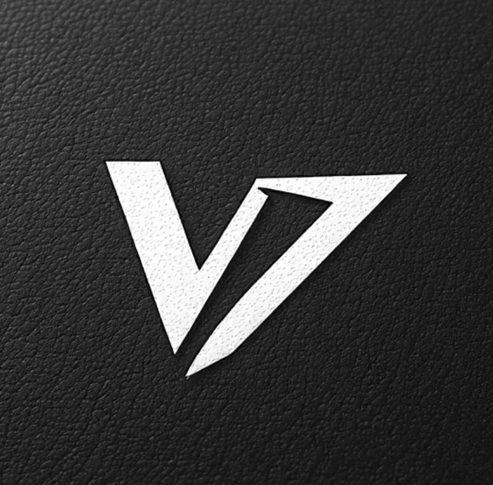

# V3XV0ID AV Client 3.1

Site and downloads: https://b0ase.github.io/vexvoid-AV-client/

## 3.1: generative sketches, real libraries, remote control

**PATTERNS → VX GEN.** Generative p5.js sketches you can play live (`vx/vx-gen.js`, p5 1.11.3 vendored in `vx/lib`).
Fifteen monochrome sketches ship in `vx/gen-library.js` (V3X TRACE, FLOW FIELD, RIDGES, GLYPH GRID, WIRE TUNNEL, TERRAIN, ORBIT HUD, ATTRACTOR, SCAN BARS, DATA RAIN, MOIRE, HARMONOGRAPH, AUTOMATA, PULSE RINGS, WIRE GLOBE); each holds ~70 fps on the output.
Every sketch reads a live `vx` object: `vx.t`, `vx.beat`, `vx.bar`, `vx.bpm`, `vx.level`/`bass`/`mid`/`high`, `vx.kick`, `vx.pulse`, `vx.seed` and four knobs `vx.a`-`vx.d`.
Edit code live (Cmd+Enter runs it and updates the output), MUTATE for a new seed, EVOLVE to drift every 4 bars, TAP the tempo, listen to the Music tab or the line in.
SEND TO OUTPUT puts the sketch on deck A or B as a layer (crossfader, opacity and blend apply; BLEND: SCREEN lays the lines over footage).
PROMPT → SKETCH has Claude write a new sketch from a sentence (needs an Anthropic key).

**MUSIC / VIDEOS / IMAGES** now use the real catalogue (`vx/catalogue.json`, rebuilt by `pnpm sync-catalogue` from vexvoid.com's data): 70 tracks, 36 clips, 81 images, all public URLs. Media is cached to disk before it goes to the output, so a set keeps running offline. Playing a track makes the sketches follow it.

**GROK IMAGINE** (Images tab): text→image, text→video and image→video through the xAI API, with the VexVoid look lines and the no-faces rule added to the prompt. Results land at the top of the Images/Videos grids; the real cost of each run is shown. Billed to your xAI key, so it is not exposed to the API, CLI or MCP.

**COMPOSER → set composer.** A set is a list of mixer commands on bars. PLAY runs it against the tempo or the playing track; `fade` steps take `over=BARS`; REC captures what you do from the UI, MIDI, the CLI and MCP; SAVE/LOAD as JSON; WRITE SET has Claude write one from a description.

**MIDI.** Click the MIDI chip in the header, press LEARN on a target, move a knob or hit a pad. Continuous targets: crossfader, knobs A-D, BPM, VX chaos, VX void chance. Pads: cut A/B, cue next/prev sketch, mutate, evolve, tap, VX next/clean/blackout, music play/pause/next.

**Local API.** While the app runs it listens on `http://127.0.0.1:4747` (`VX_API_PORT` to change). The token is in `~/.v3xv0id/api.json` (written 0600 at start); requests from web pages are refused.
`POST /api/cmd {"cmd": "...", "args": {...}}`, `GET /api/state`, `GET /api/events` (server-sent events), `GET /api/help`, `GET /api/snapshot?width=960` (JPEG of the output).

**CLI.**

```bash
pnpm mix help                      # every command
pnpm mix sketch "flow field" deck=b blend=screen
pnpm mix cue                       # next sketch onto the deck nobody is watching
pnpm mix fade 50                   # crossfader
pnpm mix load clip="jam 05" deck=a
pnpm mix play "four ton"
pnpm mix watch                     # follow the mixer live
```

**MCP.** `bin/vexvoid-mcp.js` is a dependency-free stdio MCP server (15 tools, including `mixer_snapshot` so an assistant can see the output):

```bash
claude mcp add vexvoid -- node /path/to/vexvoid-AV-client-vx/bin/vexvoid-mcp.js
```

**Keys** (only for the paid features): `ANTHROPIC_API_KEY` and `XAI_API_KEY` in the environment, or paste them into the app when it asks; they are saved in the app's own settings file on this computer (`vx-settings.json` in the app's data folder), never in the repo.

## 3.0: the VX engine (still underneath everything)

The output window now runs a layered generative engine (`vx/vx-engine.js`) underneath your own image/video layers:

- **Clip deck**: VexVoid smooth (Grok idents) and rough (writers, tunnels, trains) clips streamed from the VexVoid library. Shuffled, never repeats: random in-point, speed and zoom; mirrored except clips with lettering. Glitch cuts, ~45% void (no footage), ~35% clean (overlays fade, clip plays clean).
- **Mercury pool** (WebGL raymarch), **point fields** mutated from @yuruyurau's Processing pieces (eye, bloom, mirrored vortex, hybrid, torn ribbon; trails + band shears), **Fairlight fleck chains**, sparse fine **grain**, chaotic animated **decal livery**, glitch-cycling **V3XV0ID title**.
- **Sound**: Web Audio beep-boop engine on a look-ahead scheduler (default 100 BPM). Off by default.

Controls window: the **VX ENGINE** panel toggles every layer, sets void/clean chances, formula, decal chaos, sound/BPM/volume, plus BLACKOUT, CLEAN NOW, NEXT CLIP and RESET. Keys (both windows): B blackout, C clean, N next clip, V video, M mercury, P field, F formula, K flecks, G grain, D decals, T title, [ ] chaos, S sound, - = BPM, , . volume, 0 reset.

After editing `vx/`, run `pnpm run sync-docs` so the Pages preview uses the same engine.

### Building

```bash
pnpm install
pnpm run build-mac     # signed universal dmg + zip (Developer ID, hardened runtime)
pnpm run build-win     # nsis installer + portable
pnpm run build-linux   # AppImage + deb
```

Notarization runs when credentials are in the environment, e.g. `APPLE_KEYCHAIN_PROFILE=<profile> pnpm run build-mac` after a one-time `xcrun notarytool store-credentials <profile> ...`.

---

# V3XV0ID Image Animator

## 🎭 Professional Live Visual Performance Tool

A cutting-edge dual-palette crossfading image and video animator with V3XV0ID cyber aesthetic branding, designed for VJs, live performers, and visual artists.



## ✨ Features

### 🎛️ **Dual Palette System**
- Professional DJ/VJ-style crossfader interface
- Independent Palette A and B with seamless mixing
- Real-time crossfading between content palettes

### 🎬 **Live Video Support**
- Support for .mp4, .mov, .avi, .webm, .mkv files
- Real-time video playback with autoloop
- Mixed media support (images + videos in same layer)

### 🖼️ **Multi-Layer Image Animation**
- Unlimited layer support with individual controls
- Image sequence animation with customizable speed
- Drag-and-drop layer positioning and reordering

### 👁️ **Live Preview Windows**
- Real-time preview of Palette A content
- Real-time preview of Palette B content  
- Live mixed output preview with crossfader effects
- 20fps smooth animation in all preview windows

### 🎨 **Visual Effects**
- **Opacity Control** - Fade layers in/out
- **Scale/Size** - Resize layers dynamically
- **Jitter** - Add random movement effects
- **Strobe** - Rapid on/off flashing effects
- **Impact** - Rhythmic scale pulsing
- **Inverse Colors** - Real-time color inversion

### 🖱️ **Professional Interface**
- Intuitive drag-and-drop layer management
- Layer reordering with visual feedback
- Dual-window architecture (Control + Output)
- V3XV0ID cyber aesthetic with scan lines

### ⚡ **Performance Optimized**
- Real-time rendering for live performances
- Dual monitor support for professional setups
- Global pause/resume for precise control
- Crosshair cursor for precision positioning

## 📦 Installation

### Download Latest Release

Visit the [Releases](../../releases) page to download the latest version for your platform:

**macOS:**
- Intel Macs: `V3XV0ID-Image-Animator-vX.X.X-intel.dmg`
- Apple Silicon: `V3XV0ID-Image-Animator-vX.X.X-arm64.dmg`
- Portable: `.zip` files for both architectures

**Windows:**
- Installer: `V3XV0ID-Image-Animator-Setup-vX.X.X.exe`
- Portable: `V3XV0ID-Image-Animator-vX.X.X-portable.exe`

**Linux:**
- AppImage: `V3XV0ID-Image-Animator-vX.X.X.AppImage`
- Debian: `v3xv0id-image-animator_X.X.X_amd64.deb`

### Build from Source

```bash
# Clone the repository
git clone https://github.com/yourusername/image-animator.git
cd image-animator

# Install dependencies
npm install

# Run in development
npm start

# Build for your platform
npm run build-mac    # macOS
npm run build-win    # Windows
npm run build-linux  # Linux
```

## 🚀 Quick Start

1. **Launch** the V3XV0ID Image Animator
2. **Add Layers** to Palette A and B using the "+ ADD" buttons
3. **Load Content** into layers using the 📁 button (supports folders and individual files)
4. **Mix Palettes** using the crossfader between A and B
5. **Adjust Effects** with the controls panel (speed, size, opacity, etc.)
6. **Position Layers** by dragging them in the output window
7. **Live Performance** - Use dual monitors for control and output separation

## 🎛️ Controls Reference

### Layer Controls
- **👁️ Visibility** - Show/hide layer
- **📁 Load** - Load images/videos into layer
- **⧉ Duplicate** - Create copy of layer
- **✕ Delete** - Remove layer
- **⚫⚪ Inverse** - Toggle color inversion

### Effect Controls
- **Speed** - Animation speed (1-100ms intervals)
- **Size** - Layer scale (1-200%)
- **Jitter** - Random movement amount (0-50px)
- **Opacity** - Layer transparency (0-100%)
- **Strobe** - Flash frequency (0-20 Hz)
- **Impact** - Scale pulsing frequency (0-20 Hz)

### Global Controls
- **⏸️ Pause All** - Global pause/resume
- **🖼️ Set Background** - Default background image
- **Crossfader** - Mix between Palette A (left) and B (right)

## 🎯 Performance Tips

### For Live Shows
1. **Pre-load Content** - Load all images/videos before performance
2. **Use Dual Monitors** - Control window on laptop, output on projector
3. **Test Crossfader** - Practice smooth transitions between palettes
4. **Organize Layers** - Group similar content in same palette
5. **Use Hotkeys** - 'I' key for inverse toggle during performance

### Optimization
- Use compressed video formats (H.264 MP4 recommended)
- Keep image sequences under 100 files per layer for smooth performance
- Close other applications during live performance
- Use SSD storage for faster file loading

## 🛠️ Development

### Project Structure
```
image-animator/
├── racing-blasian/          # Main application code
│   ├── main.js             # Electron main process
│   ├── index.html          # Output window
│   ├── controls.html       # Control window
│   └── control-window.html # Legacy control window
├── .github/workflows/      # GitHub Actions CI/CD
├── dist/                   # Built distributions
└── package.json           # Project configuration
```

### Building Releases

To create a new release:

1. **Update Version** in `package.json`
2. **Commit Changes** to the repository
3. **Create Git Tag**: `git tag v1.1.0`
4. **Push Tag**: `git push origin v1.1.0`
5. **GitHub Actions** will automatically build and create the release

### Manual Building
```bash
# Build for specific platforms
npm run build-mac     # macOS (Intel + ARM64)
npm run build-win     # Windows (x64)
npm run build-linux   # Linux (x64)
npm run dist          # All platforms
```

## 🎨 V3XV0ID Aesthetic

The application features a distinctive cyber aesthetic with:
- Pure black backgrounds (#000000)
- White text and controls (#ffffff)
- Courier New monospace typography
- Scan line effects for retro-futuristic feel
- Minimalist geometric interfaces
- Crosshair cursors for precision

## 📄 License

ISC License - See LICENSE file for details.

## 🤝 Contributing

1. Fork the repository
2. Create a feature branch (`git checkout -b feature/amazing-feature`)
3. Commit your changes (`git commit -m 'Add amazing feature'`)
4. Push to the branch (`git push origin feature/amazing-feature`)
5. Open a Pull Request

## 📞 Support

For issues, feature requests, or questions:
- Open an [Issue](../../issues)
- Check existing [Discussions](../../discussions)
- Review the [Wiki](../../wiki) for advanced usage

---

**Perfect for VJs, live performers, and visual artists seeking professional-grade live visual tools with a distinctive cyber aesthetic.** 